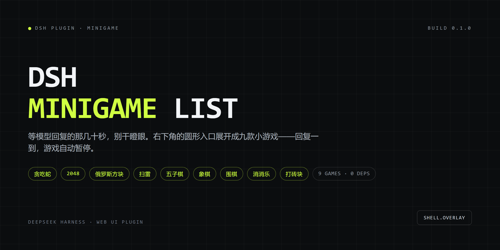
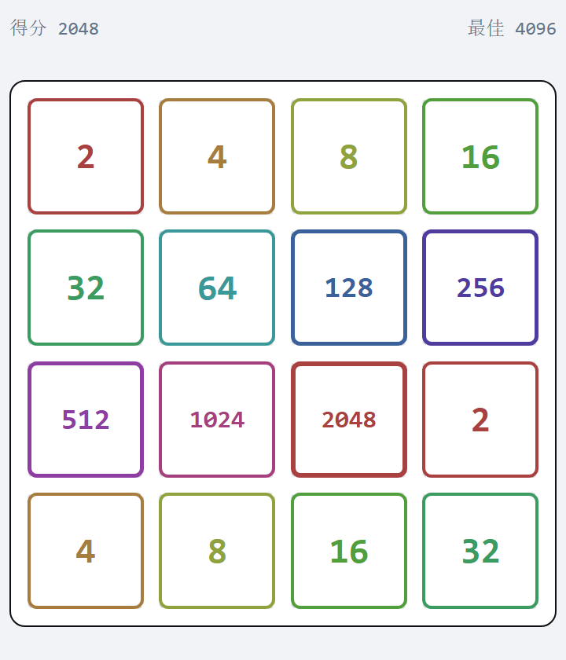
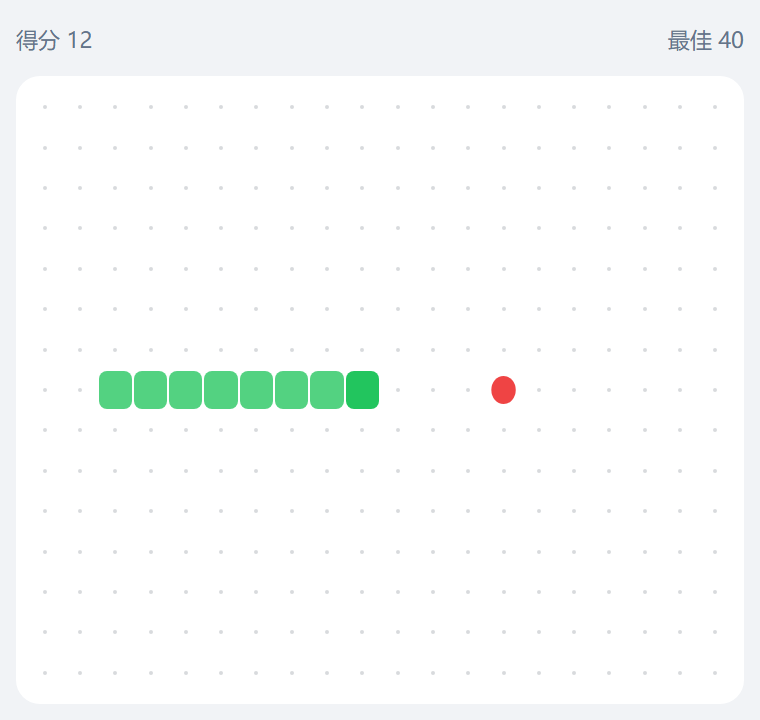
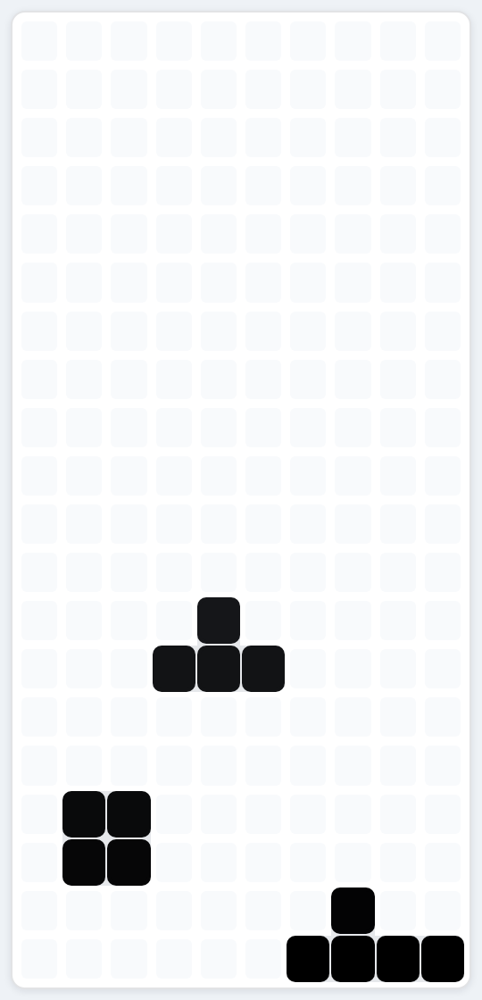

# DSH 小游戏面板 · dsh-minigame-list

> 等模型回复的那几十秒，别干瞪眼。

和模型对话时，等待回复的时间通常很枯燥：消息发出去了，光标在转，你只能盯着屏幕。这个插件在 Harness 右下角放了一个小游戏入口——等回复的时候来一局，回复到了就自动暂停，回来接着玩。



一个 DeepSeek Harness Web UI 插件：右下角的圆形按钮展开成游戏菜单，选中游戏后，同一块面板会按游戏尺寸变形为游戏窗口，黑色圆钮则变形为控制台。

九款游戏全部可玩，没有占位项：

| 游戏 | 操作 | 玩法要点 |
| --- | --- | --- |
| 贪吃蛇 | 方向键 / WASD | 撞墙从另一侧穿出；加速键提温 |
| 2048 | 方向键 / WASD | 合并到 2048，线框 + 色相环皮肤 |
| 俄罗斯方块 | ←→ / ↓ / ↑ / Enter | 空格暂停；顶部穿出升层，白底圆角 + 细缝 |
| 扫雷 | 左键翻开 / 右键标记 | 自选尺寸与密度，红色圆标标记 |
| 五子棋 | 点击落子 | 独弈 / 对弈（AI 随插件安装） |
| 象棋 | 点击选子与落子 | 人机、悔棋、难度 |
| 围棋 | 点击落子 | 停一手、数目、贴目 |
| 消消乐 | 点击交换相邻宝石 | 连锁、提示、无解重排 |
| 打砖块 | 鼠标 / ←→，Enter 发球 | 球从顶部穿出升层 |

## 特性

- **不弹独立窗口**：全部渲染在 Harness 的 `shell.overlay` 槽位里，跟随 Web UI 主题。
- **自动出现 / 自动暂停**：新一轮对话开始时菜单自动展开；回合结束或等待确认时，正在进行的游戏自动暂停。
- **关闭不丢进度**：收起面板只是失去焦点，游戏状态保留；只有控制台的“返回”会丢弃本局。
- **控制台**：返回 / 暂停 / 重来 / 发球 / 提示，随游戏出现或隐藏。
- **持久化**：最高分、扫雷/棋类设置存在 localStorage。
- **快捷键**：`P` 与空格在任意游戏里暂停/继续；各游戏专属键不会冲突。
- **零依赖**：纯 Host + Client 插件，不需要额外 npm 包或服务。

## 截图

| 2048 | 贪吃蛇 |
| --- | --- |
|  |  |



## 安装

### 本地 bundle

```bash
dsh plugin add "C:\path\to\dsh-minigame-list"
```

或在 Harness 里用 `plugin_manager` 的 `install_bundle` 指向本目录。安装后刷新页面，右下角出现圆形入口。

### 通过插件市场

插件市场是 DSH 的 JSON 索引。把本仓库的 `market/index.json` 放到任意静态主机（例如 GitHub Pages），在 **插件 → 发现 → 添加索引源** 里填入它的 URL 即可。

索引里的版本指向本仓库的某个提交；发布新版本后更新 `commit` 和 `version` 即可。

## 结构

```
dsh-minigame-list/
├─ client.js         # 全部 UI 与游戏逻辑（Client）
├─ index.js          # Host 入口（apply）
├─ cordis.patch.yml  # bundle 清单：注册 minigame-list 行
├─ locale/           # en / zh 显示文案
├─ icon.svg          # 插件图标
├─ assets/           # 截图与宣传图
└─ market/index.json # 插件市场索引
```

## 开发

- 客户端在 `client.js` 里通过 `window.__ModuleLoader__.load({ id, factory })` 注册，向 `shell.overlay` 插槽注册 `minigame-launcher`。
- 游戏均为纯函数 + React 组件；`tools/*-logic-check.mjs` 是本地逻辑回归脚本（从源码抽取纯函数在 `node:vm` 里跑）。
- 修改后刷新页面即可（profile 内为符号链接）。

## License

MIT
